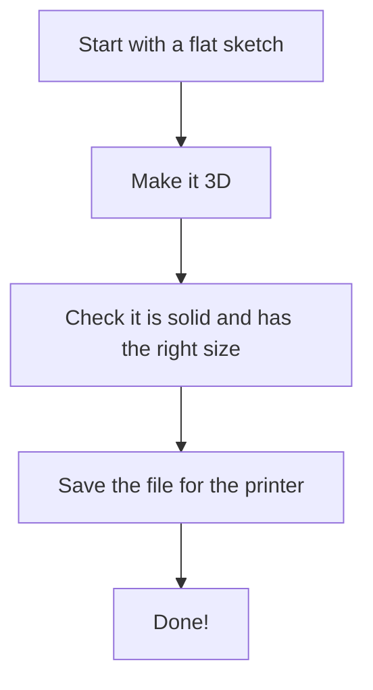
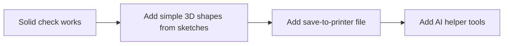

# Getting Started with Grok Build

**Simple guide for the CAD/CAM MVP**  
**Date**: 2026-10-20

## What we are building (very simple)

We are making a computer program that helps people design 3D shapes.

The shapes must be solid (no holes or missing pieces) so a 3D printer can print them correctly.

The program should:
- Let you start with a flat drawing and turn it into a 3D shape.
- Check that the shape is solid and ready to print.
- Save the shape as a special file (STL or 3MF) that printers understand.

That is the whole goal for the first version (MVP).

## The big picture (simple steps)



## What is Grok Build?

Grok Build is a smart helper that lives in your computer’s terminal (the black or white text window).

You tell it what to build.  
It can plan, write code, and fix things for you.  
You always get to look at the changes before they are final.

We start with Grok Build because it is good at the big first pieces of code.

## First steps (do these in order)

### Step 1: Get a folder ready
- Create a new folder on your computer for the project.
- Name it something simple like `cad-mvp`.
- Put a copy of the project documents in it (especially `mvp/requirements.md` and `AGENTS.md`).

### Step 2: Install Grok Build
Open your terminal and type:

```bash
curl -fsSL https://x.ai/cli/install.sh | bash
```

(On Windows PowerShell use the other install command from the Grok site.)

Then close and open the terminal again.

### Step 3: Go into the folder and start
```bash
cd cad-mvp
grok
```

The first time it will ask you to log in with your Grok account.

### Step 4: Give it a simple first job (use plan mode)
Type something like this:

```
/plan
Look at mvp/requirements.md and AGENTS.md.
Make a short plan for the very first piece of code:
a small C++ program that can load a simple 3D shape and check if it is solid (watertight).
Show the plan and wait for me to say yes before writing any code.
```

### Step 5: Review the plan
- Read what it suggests.
- Say yes if it looks good, or tell it what to change.
- Only after you say yes does it start writing code.

### Step 6: Look at the results
- It will show you the changes (called a diff).
- Check that it stayed simple and only did the solid-check piece.
- Save the work if it looks correct.

## Simple rules while we work

- Always start big jobs with `/plan` so we can check the idea first.
- The shape must always pass the “is it solid?” test before we save it.
- Do not add extra features yet (no full robot arm paths or fancy physics).
- Keep notes of what we did in the project documents.

## What we will do next (after the first solid check)



## Open questions (we can answer later)

- What computer system are you using (Mac, Windows, Linux)?
- Do you already have a C++ compiler installed?
- Where do you want the project folder to live?

## Done for now

You have a simple starting plan.  
Follow the steps above, then come back with the first plan Grok Build creates so we can review it together.
