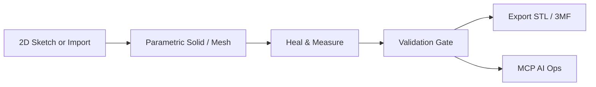

# MVP Requirements: Design-to-Print CAD Tool

**Status**: Confirmed  
**Date**: 2026-10-20  
**Scope**: Single-part 2D/3D design → STL/3MF for any slicer. Browser-portable target (WASM). C++ kernel preferred.

## Overview

Tool for creating precise or freeform 3D parts from 2D sketches or direct modeling, then exporting clean, slicer-ready files. Priority is reliable print output over full CAM or advanced simulation.

> [!IMPORTANT]
> Units must be locked and carried into the file.

## Goals

- 2D sketch (constraints) → 3D solid or mesh (extrude, revolve, boolean, fillet, freeform).
- Parametric history + direct edits.
- High-quality tessellation to STL and 3MF.
- MCP AI for natural-language design and validation ops.
- Basic measurements, healing, and export validation.

## Non-Goals (MVP)

- Full CAM toolpaths or machine simulation.
- 5-axis, generative design, advanced FEA, thermal, or motion studies.
- Multi-user collaboration, version control, or cloud features.
- PCB, sheet metal, or complex assemblies.
- Photorealistic rendering.

## Must-Have Features

| Feature | Acceptance Criteria |
|---------|---------------------|
| Units lock | Explicit mm/inch toggle; export includes correct units |
| Geometry healing | One-click or automatic fix for non-manifold edges, flipped normals, small gaps |
| Measurements | Viewport readouts for distance, angle, radius, and volume |
| Import | Baseline STL and STEP import |
| Export validation | Units pass/fail + recommended tessellation quality before download; free-edge count shown as information only |
| 3MF support | Units, single material/color, multi-body packing |
| Undo/redo + autosave | Reliable session history so modeling is not fragile |
| Selection & snapping | Face/edge/vertex selection + basic grid and vertex snapping |

## Core User Flow

> [!TIP]
> Default tessellation to “slicer-safe” (consistent normals, no holes). Allow user override for higher resolution.

## AI / MCP

- Built-in MCP server exposing: create sketch, extrude, fillet, boolean, heal, measure, validate, export.
- Agent can execute “add 2 mm fillet, check printability, and export 3MF”.

## Technical Notes

- Preferred: C++ + OpenCASCADE (OCCT) for B-Rep precision and STEP support.
- Browser path: Emscripten/WASM possible; watch binary size, boolean performance, and memory limits.
- Desktop fallback recommended for heavy operations.
- Hybrid: B-Rep for engineering features + mesh for organic shapes.

## Phone UI (main, team-locked)

- **Callout hide (accepted 2026-10-26, Erik retest)**: On phone, while editing a basic shape (box / cylinder / disc, no sketch specs), `#calloutLayer` stays hidden. Size stays editable on `#dimPanel` / Properties (`boxSx`/`boxSy`/`boxSz`, cyl/disc Size). Shipped PR #123 merge `907402c` (tip `202a737`).
- **`#dimPanel` keep-lock (Chief, 2026-10-26 ~1:09 AM MT)**: Keep the dim body (Size / Centre / Rot / axis / bbox / hole). No full remove until those fields migrate into Properties and phone typed resize is confirmed. Later safe cut only: drop gizmo row / thin selection bar. No `#dimPanel` remove code until then.

## Overnight queue + wake acceptance (team-locked 2026-10-26 ~3:07 AM MT)

Erik hands-off overnight; final tool tests on wake. Stuck/help check every **20 minutes**. Coding stays **Antigravity-only on Z13**. Do not ping Erik overnight unless irreversible.

### Finish current first
1. **Rust #1** — Antigravity units + volume Export-gate mirror (`prompts/antigravity-rust-units-gate.md`, main base `2e57032` / tip after #127 `16500e8`): dual-run vs `Module.gate()`, C++ authoritative, no OCCT. Cascade: tip-match → merge → UPDATES (Repo Keeper) → Pages.

### Then overnight (order; do not park)
1. Fully implement sketches + dimensioning and visualization so precise geometry/sketches work.
2. Bug: Create Sketch with **no solid** for the plane must **not** spawn a box — find/fix.
3. View cube: flip based on **swipe direction**.
4. Selection switching: vertex/edge/face must not leave the whole-body gizmo; switching must work.
5. Print models — **discuss first** what sketch+Boolean already do; then decide fixes/impl to rebuild prior models **from scratch** maximizing sketch+Boolean. Bracket = same features. Toy truck = define bed, wheel spokes, tire tread, interior, **separate door parts**. Then OrcaSlicer plates for Bambu X1C (**no printer send** unless Erik said otherwise).
6. E2E: design → export STL / 3MF / STEP (+ whatever else already supported). Account for visuals/callouts; keep tools/panels from blocking the subject as little as possible. Pack any extra features needed to finish the above.

### Holds (unchanged unless a queue item reopens them)
- Phone T2 (move-gizmo) still held unless queue (4) requires it.
- Watertight stays dropped as Export gate; units + OCCT-after-ops rules stay.
- `#dimPanel` keep-lock above still applies.

### Wake acceptance (Erik final tests when awake)
Leave smokes and Pages ready for:
- Sketch (precise geometry / dimensioning path from queue item 1)
- Boolean
- Selection (vertex/edge/face switching, queue item 4)
- View-cube swipe flip (queue item 3)
- Exports (STL / 3MF / STEP + existing formats; E2E queue item 6)

CI smoke + Pages green on main is the overnight bar; Erik's wake retest is the human gate.

## Success Criteria

- User can go from blank sketch to validated, slicer-ready 3MF in a few minutes.
- Files open correctly in common slicers (PrusaSlicer, Orca, Bambu Studio, Cura) without scale or manifold errors.
- MCP commands reliably modify the model and trigger validation.

> [!NOTE]
> This document covers only the MVP. See `/vision/full-project.md` for post-MVP goals. Changes here do not affect the vision document.
