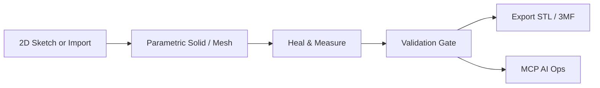

# MVP Requirements: Design-to-Print CAD Tool

**Status**: Confirmed  
**Date**: 2026-10-20  
**Scope**: Single-part 2D/3D design → watertight STL/3MF for any slicer. Browser-portable target (WASM). C++ kernel preferred.

## Overview

Tool for creating precise or freeform 3D parts from 2D sketches or direct modeling, then exporting clean, slicer-ready files. Priority is reliable print output over full CAM or advanced simulation.

> [!IMPORTANT]
> All geometry must pass a manifold/watertight check before export. Units must be locked and carried into the file.

## Goals

- 2D sketch (constraints) → 3D solid or mesh (extrude, revolve, boolean, fillet, freeform).
- Parametric history + direct edits.
- High-quality tessellation to STL and 3MF.
- MCP AI for natural-language design and validation ops.
- Basic measurements, healing, and export validation.

## Non-Goals (MVP)

- Full CAM toolpaths or machine simulation.
- 5-axis, generative design, advanced FEA, thermal, or motion studies.
- Multi-user collaboration, version control, or cloud features.
- PCB, sheet metal, or complex assemblies.
- Photorealistic rendering.

## Must-Have Features

| Feature | Acceptance Criteria |
|---------|---------------------|
| Units lock | Explicit mm/inch toggle; export includes correct units |
| Geometry healing | One-click or automatic fix for non-manifold edges, flipped normals, small gaps |
| Measurements | Viewport readouts for distance, angle, radius, and volume |
| Import | Baseline STL and STEP import |
| Export validation | Clear pass/fail on watertight status + recommended tessellation quality before download |
| 3MF support | Units, single material/color, multi-body packing |
| Undo/redo + autosave | Reliable session history so modeling is not fragile |
| Selection & snapping | Face/edge/vertex selection + basic grid and vertex snapping |

## Core User Flow

> [!TIP]
> Default tessellation to “slicer-safe” (consistent normals, no holes). Allow user override for higher resolution.

## AI / MCP

- Built-in MCP server exposing: create sketch, extrude, fillet, boolean, heal, measure, validate, export.
- Agent can execute “add 2 mm fillet, check printability, and export 3MF”.

## Technical Notes

- Preferred: C++ + OpenCASCADE (OCCT) for B-Rep precision and STEP support.
- Browser path: Emscripten/WASM possible; watch binary size, boolean performance, and memory limits.
- Desktop fallback recommended for heavy operations.
- Hybrid: B-Rep for engineering features + mesh for organic shapes.

## Success Criteria

- User can go from blank sketch to validated, slicer-ready 3MF in a few minutes.
- Files open correctly in common slicers (PrusaSlicer, Orca, Bambu Studio, Cura) without scale or manifold errors.
- MCP commands reliably modify the model and trigger validation.

> [!NOTE]
> This document covers only the MVP. See `/vision/full-project.md` for post-MVP goals. Changes here do not affect the vision document.
