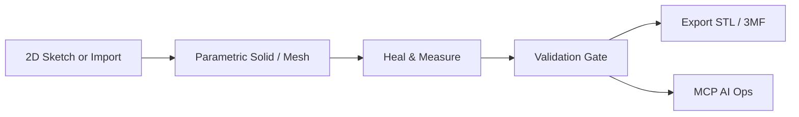

# MVP Requirements: Design-to-Print CAD Tool

**Status**: Confirmed  
**Date**: 2026-10-20  
**Scope**: Single-part 2D/3D design → STL/3MF for any slicer. Browser-portable target (WASM). C++ kernel preferred.

## Overview

Tool for creating precise or freeform 3D parts from 2D sketches or direct modeling, then exporting clean, slicer-ready files. Priority is reliable print output over full CAM or advanced simulation.

> [!IMPORTANT]
> Units must be locked and carried into the file.

## Goals

- 2D sketch (constraints) → 3D solid or mesh (extrude, revolve, boolean, fillet, freeform).
- Parametric history + direct edits.
- High-quality tessellation to STL and 3MF.
- MCP AI for natural-language design and validation ops.
- Basic measurements, healing, and export validation.

## Non-Goals (MVP)

- Full CAM toolpaths or machine simulation.
- 5-axis, generative design, advanced FEA, thermal, or motion studies.
- Multi-user collaboration, version control, or cloud features.
- PCB, sheet metal, or complex assemblies.
- Photorealistic rendering.

## Must-Have Features

| Feature | Acceptance Criteria |
|---------|---------------------|
| Units lock | Explicit mm/inch toggle; export includes correct units |
| Geometry healing | One-click or automatic fix for non-manifold edges, flipped normals, small gaps |
| Measurements | Viewport readouts for distance, angle, radius, and volume |
| Import | Baseline STL and STEP import |
| Export validation | Units pass/fail + recommended tessellation quality before download; free-edge count shown as information only |
| 3MF support | Units, single material/color, multi-body packing |
| Undo/redo + autosave | Reliable session history so modeling is not fragile |
| Selection & snapping | Face/edge/vertex selection + basic grid and vertex snapping |

## Core User Flow

> [!TIP]
> Default tessellation to “slicer-safe” (consistent normals, no holes). Allow user override for higher resolution.

## AI / MCP

- Built-in MCP server exposing: create sketch, extrude, fillet, boolean, heal, measure, validate, export.
- Agent can execute “add 2 mm fillet, check printability, and export 3MF”.

## Technical Notes

- Preferred: C++ + OpenCASCADE (OCCT) for B-Rep precision and STEP support.
- Browser path: Emscripten/WASM possible; watch binary size, boolean performance, and memory limits.
- Desktop fallback recommended for heavy operations.
- Hybrid: B-Rep for engineering features + mesh for organic shapes.
- **Rust WASM slice #1 (dual-run shadow)**: `rust/cadcam_gate` (`wasm32-unknown-unknown`, loaded via `web/rust-gate.mjs`) mirrors the millimeter units lock (`to_display`, `to_millimeters`, `export_units_pass`) and signed mesh volume (`mesh_volume_mm3`, `evaluate_rust_gate`) alongside C++ `Module.gate()`, publishing `#statusRustGate` and `window.__cadcamRustGate` (`matchesCpp`). C++ `Module.gate()` remains authoritative for Export button enablement; no OCCT / `libcascade` in Rust; watertight remains dropped as an Export gate. TBD: whether Rust replaces C++ `Module.gate()` is deferred until Erik decides.
- **Rust CLI slice #2 (CI dual-run shadow)**: `rust/cadcam_check_export` (`cadcam_check_export`, pure-Rust host CLI using `stl_io`, `zip`, and `quick-xml`) dual-runs in CI beside `tools/check_export.py` on `builds/export/box.stl` and `builds/export/box.3mf` (`--expect-size 20 20 20 --expect-volume 8000`); Python stays; `is_watertight` stays INFO-only and never decides the exit code.

## Phone UI (main, team-locked)

- **Callout hide (accepted 2026-10-26, Erik retest)**: On phone, while editing a basic shape (box / cylinder / disc, no sketch specs), `#calloutLayer` stays hidden. Size stays editable on `#dimPanel` / Properties (`boxSx`/`boxSy`/`boxSz`, cyl/disc Size). Shipped PR #123 merge `907402c` (tip `202a737`).
- **`#dimPanel` keep-lock (Chief, 2026-10-26 ~1:09 AM MT)**: Keep the dim body (Size / Centre / Rot / axis / bbox / hole). No full remove until those fields migrate into Properties and phone typed resize is confirmed. Later safe cut only: drop gizmo row / thin selection bar. No `#dimPanel` remove code until then.

## Overnight queue + wake acceptance (team-locked 2026-10-26 ~3:07–3:13 AM MT)

Erik hands-off overnight; final tool tests on wake. Stuck/help check every **20 minutes**. Coding stays **Antigravity-only on Z13**. Open questions: team discuss → 3T / Chief final call (no wait on Erik). Ping Erik only for irreversible or out-of-scope.

### Finish current first
1. **Rust #1** — Antigravity units + volume Export-gate mirror (`prompts/antigravity-rust-units-gate.md`): dual-run vs `Module.gate()`, C++ authoritative, no OCCT. Cascade: tip-match → merge → UPDATES (Repo Keeper) → Pages.

### Overnight locks (Chief/3T final, 2026-10-26)
- **(a)** Precise sketch = typed mm + callouts; **no** constraint solver.
- **(b)** **Keep boot cube**; Create Sketch empty path must never spawn a box (smoke: delete-all → New Sketch → `bodies.length===0` + `#originPlanes`).
- **(c)** View cube = **adjacent** face step; map swipe so direction matches “flip with swipe” (invert L/R if needed). Not opposite-face.
- **(d)** **Hide gizmo** in vertex/edge/face; keep for body/item.
- **(e)** E2E tonight = **STL + 3MF** only; STEP later.
- **(f)** Q5 discuss locked 2026-10-26 ~7:37 AM MT (below). Truck still TBD.

### Q5 discuss (team-locked 2026-10-26 ~7:37 AM MT)

Chief Q5, after overnight (1)–(4). No invented sizes; every missing dimension is **TBD**.

- **Primary rebuild** = phone L-bracket acceptance: 3 countersunk holes per leg + off-centre disc, via **sketch → Blind Extrude (New/Join/Cut) + Union/Cut**. Prefer the sketch path over primitives-only (`prompts/mobile-5-booleans.md`).
- `mvp/projects/blink-l-bracket.md` is **reference only**. Do not bake Blink layout or dimensions into the app or scene.
- **Truck** = discuss/spec only until sizes exist. **No invent**; flag **TBD**. Rebuild after L-bracket acceptance, or when Erik supplies sizes.
- **Union/Cut enough** for this rebuild. Intersect is not required (Intersect may remain in the UI). Extrude Intersect stays out of the Join/Cut MVP slice (Chief lock 2026-10-26, **team-chosen**).
- **No printer** send for Q5.
- **Dims Erik TBD** (do not invent): leg A/B length×width; fit/clearance to frame casing; leg screw hole size, countersink, and spacing; Blink boss diameter/height; disc diameter and placement; disc screw count/size/pattern; Blink model; casing profile; screw gauge; printed hole oversize; material/printer. Fillet/chamfer defaults are the Chief lock below (**2 mm / 0.5 mm**), not part of this list.
- **Locked** (restated from `mvp/projects/blink-l-bracket.md` only): wall thickness **4 mm**, disc thickness **4 mm**, corner **90°**, units **mm**. Rebuild scope also includes **3 CSK/leg** and the off-centre disc. Every L-bracket dimension beyond wall/disc 4 mm, 90°, 3 CSK/leg, and the off-centre disc stays **Erik TBD**.

#### Toy truck feature list (discuss/spec; Digest 2026-10-26 ~8:14 AM MT; Chief locks same day)

Parked under this Q5 discuss note. The L-bracket stays the primary rebuild. Locked L-bracket values above are unchanged. The truck stays discuss/spec. Queue it after the Q5 L-bracket. **Rebuild the truck only after L-bracket acceptance.** Units **mm**. Prefer **sketch → Blind Extrude + Union/Cut**. Extrude Intersect stays out of the Join/Cut MVP slice. Intersect is not required. **No printer** send for Q5.

Acceptance B sizes stay the discuss baseline only. Every size below is a **sourced team-chosen baseline** from Acceptance B (sourced, not invented). They are not Q5 locks. Prefer the **11-part** assembly (PLA hubs + TPU tires).

- **Chassis/body** — MVP — plate 80×30×6 mm; two Ø4.4 through-holes across the 30 mm width, 10 mm in from each end, 3 mm up. **Sourced team-chosen baseline** (Acceptance B; PLA).
- **Cab** — MVP — 30×30×25 mm box on the chassis front; Union into the chassis → 11 parts after combine. **Sourced team-chosen baseline** (Acceptance B; PLA).
- **Bed/cargo box** — discuss — dimensions **Erik TBD**. Do not invent.
- **Axles ×2** — MVP — Ø4×44 mm (PLA). **Sourced team-chosen baseline** (Acceptance B).
- **Wheel hubs ×4** — MVP — Ø16×8 mm with Ø4.2 bore (PLA). **Sourced team-chosen baseline** (Acceptance B). Bore via Cut.
- **Tires ×4** — MVP for Acceptance B materials — ring OD 24 / ID 15.6 / width 8 (TPU; 0.2 stretch on the hub). **Sourced team-chosen baseline** (Acceptance B).
- **Spokes** — discuss — dimensions **Erik TBD**. Do not invent.
- **Tread** — discuss — dimensions **Erik TBD**. Do not invent.
- **Interior** — discuss — dimensions **Erik TBD**. Do not invent.
- **Doors** — discuss — dimensions **Erik TBD**. Do not invent.
- **Boolean cuts** — axle holes, hub bore, and tire ID via Cut; body joins via Union. Prefer the **11-part** assembly (PLA hubs + TPU tires).
- **Multi-plate Orca (PLA + TPU 95A)** — Acceptance B check, later relative to this Q5 discuss. **No printer** send.

**Rebuild path** (only after L-bracket acceptance): sketch → Blind Extrude → Union/Cut → units + OCCT validity; export STL/3MF in mm when the export gate passes. Prefer the **11-part** assembly (PLA hubs + TPU tires).

**Fillet/chamfer defaults:** **2 mm / 0.5 mm** (Chief lock 2026-10-26 ~1:02 PM MT; **team-chosen**; Chief: already in code). This replaces "non-blocking / no values until sourced" for these defaults only. Other TBD dimensions stay TBD.

#### Chief lock (2026-10-26 ~1:02 PM MT)

Chief lock via Digest sketch→Boolean shortlist. Do not invent. (1) and (2) are **Erik TBD**. (3), (4), and (5) are **team-chosen**.

1. L-bracket dimensions beyond wall/disc **4 mm**, corner **90°**, **3 CSK/leg**, and the off-centre disc stay **Erik TBD**. Do not invent.
2. Truck discuss parts (bed/cargo box, spokes, tread, interior, doors) stay **Erik TBD**. Do not invent. Acceptance B sourced baselines in the list above are unchanged.
3. OCCT `SetFuzzyValue` for near-coincident Booleans = **0.01 mm** (Chief lock; OCCT example 1e-5 scaled for our mm). **Team-chosen.**
4. Drag preview = **Option C**: ghost transform while drag; exact OCCT Boolean on release. Extrude Intersect stays out of the Join/Cut MVP slice. **Team-chosen.**
5. Fillet/chamfer defaults = **2 mm / 0.5 mm** (Chief: already in code). **Team-chosen.** Supersedes "fillet/chamfer non-blocking / no values until sourced" for these defaults only.

**Sources:** `mvp/acceptance-a-b.md` (truck parts, team-chosen 07:10 MT; 11 parts after the cab combine, Chief and 3T 07:15 MT); `web/PROGRESS.md` (07:10 and 07:15 notes); `research/assemblies.md` and `prompts/assemblies.md` (flat parts list, Combine, per-part 3MF, mm); `prompts/mobile-5-booleans.md` (Union/Cut; Intersect may stay in the UI; L-bracket sketch path); Q5 locks in this section (PR #150, merge `a38d89d`). Chief locks in this subsection (2026-10-26): Acceptance B sizes stay the discuss baseline only; prefer the 11-part assembly (PLA hubs + TPU tires); fillet/chamfer defaults **2 mm / 0.5 mm** (team-chosen, already in code); truck rebuild only after L-bracket acceptance. Chief refine same day: bed, spokes, tread, interior, and doors stay on the discuss list with dimensions **Erik TBD**. Chief lock ~1:02 PM MT via Digest shortlist: Fuzzy **0.01 mm**, drag preview **Option C**, Extrude Intersect out of Join/Cut MVP.

### After Rust #1 tip — Antigravity order
1. (2) Empty-sketch / no-solid Create Sketch never spawns box.
2. (4) Selection V/E/F: hide whole-body gizmo.
3. (3) View-cube swipe direction (adjacent).
4. (1) Sketch + dimensioning/visualization (typed + callouts; no solver).

### Rust conversion (continues; parallel when Independent)
- After #1: keep **dual-run shadow**, C++ boss, until smokes stay green.
- Next Independent: **#2** Rust CLI port of `tools/check_export.py` (CI-first).
- Then **#4** `.cadmvp` schema validate only if schema stays frozen.
- **`.cadmvp` freeze status: TBD (no freeze stamp).** There is no frozen schema file/stamp on main. **Rust #4 stays HOLD** until the team freezes `.cadmvp` and a brief exists.
- Skip #3 (watertight reopen), #5/#6 (OCCT/truck / AGPL bindings) for now.
- Parallelize Independent Rust with overnight UI slices when not blocked.

### Holds
- Phone T2 (move-gizmo) still held unless (4) requires related work.
- Watertight stays dropped as Export gate; units + OCCT-after-ops rules stay.
- `#dimPanel` keep-lock still applies.
- No printer send unless Erik said otherwise.

### Wake acceptance (Erik final tests when awake)
Leave smokes and Pages ready. **Human gate** = Erik runs this on [Pages](https://cyborgpencil.github.io/cad-mvp/) (or live main) after overnight lands. CI smoke + Pages green on main is the overnight bar.

#### Wake smoke checklist
1. **Empty sketch / boot cube (lock b)** — Delete-all → Create Sketch (no solid) → confirm odies.length===0 and #originPlanes visible; boot cube still present on fresh load (not removed).
2. **Sketch typed + callouts (lock a / queue 1)** — New Sketch on Top → draw closed profile → typed mm sizes via Properties/#dimPanel → callouts show matching values (no constraint solver expected).
3. **Boolean** — Two bodies → Union or Cut → result solid; undo restores prior.
4. **Selection V/E/F (lock d / queue 4)** — Switch vertex / edge / face: whole-body gizmo **hidden** in those modes; body/item mode still shows gizmo.
5. **View-cube swipe (lock c / queue 3)** — Swipe so the **adjacent** face steps in the swipe direction (not opposite-face flip). Invert L/R only if direction feels wrong.
6. **Export STL + 3MF (lock e)** — Box or boolean result → Export STL and 3MF → units mm; Export enabled only when C++ Module.gate() passes (Rust dual-run may show #statusRustGate / window.__cadcamRustGate.matchesCpp===true when loaded — informational). Concrete bar: Export acceptance checks (queue item 6) below, including the post–Q5 L-bracket solid when it exists.
7. **Phone sanity (if testing phone)** — Basic-shape edit: #calloutLayer hidden; Size still editable on #dimPanel. No printer send.

Pass = all seven feel right; fail notes go to the room (team discuss → Chief/3T call).

#### Export acceptance checks (queue item 6)

Concrete bar for wake checklist item 6 / lock **(e)**. Pilot runs it after the Q5 L-bracket rebuild, and the same checks cover an ordinary boot box or boolean export. E2E stays STL + 3MF only; STEP later. Write blocks match `mvp/export.md`.

- **Export enable.** The Export button is enabled only when C++ `Module.gate()` passes (units mm). `#statusRustGate` and `window.__cadcamRustGate.matchesCpp` are informational when the Rust dual-run has loaded. OCCT-after-ops still runs and does not block Export.
- **Both files.** Export STL and 3MF successfully for (a) the boot box or a boolean result and (b) the post–Q5 L-bracket solid when that solid exists. L-bracket path: sketch → Blind Extrude (New/Join/Cut) + Union/Cut. `mvp/projects/blink-l-bracket.md` is reference only.
- **Units in the file.** The 3MF model unit is `millimeter`. STL coordinates are millimeters.
- **Write blocked.** No triangles → `FAIL: mesh has no triangles.` Zero or non-positive volume on the floor (|volume| <= 1e-9 mm3) → `FAIL: mesh has zero volume.` Inside-out (negative volume, volume < -1e-9 mm3) → `FAIL: mesh is inside-out (negative volume).` Each of these blocks the write.
- **INFO only.** Free-edge count and `is_watertight` are shown as information only. They do not gate Export. `is_watertight` does not decide the offline checker exit code.
- **Optional offline expect.** When expected size and volume are known, run `tools/check_export.py` and/or `cadcam_check_export` on the STL and 3MF. CI box (20 × 20 × 20 mm, volume 8000 mm3): `--expect-size 20 20 20 --expect-volume 8000` on `builds/export/box.stl` and `builds/export/box.3mf`. L-bracket: skip that numeric expect until dimensions lock. Both tools require `--expect-size` and `--expect-volume`, so do not invoke them on the L-bracket files while size or volume is TBD. Until then the L-bracket bar is a successful STL + 3MF export, units mm, and the C++ gate. Locked physical values only: wall thickness 4 mm, disc thickness 4 mm, corner 90°, units mm. Every other size stays TBD.
- **No printer.** No printer send for Q5 or this acceptance.

Pass = STL and 3MF written for each solid under test, units mm, C++ `Module.gate()` passed, and none of the write-block messages on those files. Watertight stays INFO. L-bracket numeric expect stays skipped while sizes are TBD.

## Queued after current in-flight (discuss / parked)

End of queue (Erik via 3T, 2026-10-26 ~8:31 AM MT, ~8:46 AM MT, ~9:44 AM MT, ~10:27 AM MT, ~4:40 PM MT, and ~5:18 PM MT; Chief lock). **Status: discuss / parked.** Start only after the L-bracket Antigravity brief and tipped docs #155, #154, and #156 have cleared, and after remaining in-flight coding clears. L-bracket `agy` has already cleared via merged #165. Leave Pilot uninterrupted for any remaining coding. Sketch chrome minimize and the Create → ortho plane sketch flow (#183 / `prompts/antigravity-sketch-chrome-flow.md`) are the **in-flight / next coding slice** (Create→six ortho→sketch tools + Finish Sketch). **Sketch draw interaction overhaul** is next after that chrome slice tip-merges (park + brief: `prompts/antigravity-sketch-draw-overhaul.md`; Erik via 3T, 2026-10-26 ~5:18 PM MT). The overhaul sits on Create→ortho→strip from #183 and does not rework that strip or Finish Sketch. X-ray (#163) and panel chrome (#167) stay later in the queue. No Antigravity prompt yet for X-ray, panel labels, or always-visible chrome. Overnight locks (c) and (d), the Q5 discuss locks, and the export acceptance checks stay as written above. Unspecified details stay **TBD**.

- **Top-bar shelf icons (selection + show/hide camera)**
  - Move the **selection** sliding toolbar and the **show/hide camera** sliding toolbar into **icons on the top bar, to the right of the tools menu**.
  - Separate by tool type. Selection gets its own icon group. Any further tool-type groups are **TBD**.
  - Same behavior as the tools menu: press the icon to show or hide that shelf.
  - **TBD:** icon art, pixel sizes, hotkeys, which existing controls are the selection shelf and which are the show/hide camera shelf, which bar is the top bar (header or the ribbon that holds the Tools menu), phone and desktop placement, and whether any shelf besides those two moves.
- **View cube**
  - More predictable swipe: each swipe up, down, left, or right rotates the view cube and the camera in that direction. The direction is screen-relative and independent of the model orientation.
  - **Press-and-hold** for a slow continuous view-cube and camera adjust.
  - **Home** shortcut: center on the selected model when something is selected; otherwise center on **0,0,0**.
  - **TBD:** pixel thresholds, hold timing, and the Home key binding.
- **Gizmo fix**
  - The gizmo centers on the selection (one selection, or a multi-component / multi-object selection).
  - Tap empty space hides the gizmo or moves it off.
  - With multi-select off: tap vertex 1, then vertex 2, and the gizmo moves from vertex 1 to vertex 2.
  - **TBD:** any tap or pixel threshold not stated here.
- **Dimensions**
  - Show a dimension on **each line**, with that line's length, as in other CAD apps.
  - **TBD:** which dimension style.
- **X-ray select-through**
  - Select-through-objects (click-through / pick past front faces) is allowed **only when X-ray is on**.
  - When X-ray is **off**, pick must hit the **frontmost surface only** — no click-through to objects behind.
  - **Status: discuss / parked.** Implement only after L-bracket `agy` and the rest of the current coding queue clear. No Antigravity prompt yet.
  - **TBD:** what the app’s X-ray control is named/where it lives, any pick-tolerance or depth-buffer details not stated by Erik.
- **Panel labels**
  - Every panel must be labeled.
  - **Status: discuss / parked.** Implement only after the current coding queue clears. No Antigravity prompt yet.
  - **TBD:** exact label text per panel, which surfaces count as panels, and phone vs desktop label placement.
- **Always-visible chrome (permanent panels)**
  - The only panels that stay visible 100% of the time are: the **very top** (tree + filename), the **tools menu bar**, and the **very bottom** (Modify / Create etc.).
  - Everything else must not stay on-screen permanently; use show/hide like other shelves.
  - **Status: discuss / parked.** Implement only after the current coding queue clears. No Antigravity prompt yet.
  - **TBD:** which existing UI regions map to “very top / tools menu bar / very bottom”, which other panels currently stay permanent and must become shelves, and any exceptions Erik did not state.
- **Sketch chrome minimize (active sketch)**
  - **Problem:** Arc+polygon hard to test — Arc dialog + floating toolbars eat the viewport.
  - While a sketch process is active, **minimize / hide non-sketch chrome** — only sketching tools stay visible. Erik referred to the blue-circled sketch tool strip in his phone screenshot; do not invent which control ids that strip maps to. Hide the other floating shelves that crowd the view.
  - **Status: discuss / parked → next coding after #181.**
  - **TBD:** which existing shelves/panels count as non-sketch chrome vs the sketch tool strip; phone vs desktop placement; whether always-visible chrome from the prior park (very top / tools menu bar / very bottom) stays visible during sketch; Arc dialog placement beyond “don’t eat the viewport”.
- **Sketch Create → ortho plane → sketch tools flow**
  - Press Create.
  - Pick any of the **six** orthographic views/planes: Front, Back, Top, Bottom, Left, Right.
  - Once a plane/view is chosen, hide that view-selection menu and show **only** sketch-create tools.
  - Keep **Finish Sketch**.
  - **Status: discuss / parked → next coding after #181.**
  - **TBD:** Create vs New Sketch naming if the UI differs; whether this replaces the current face-tap sketch plane path or is additive; control ids; layout of the six-plane picker.
- **Sketch draw interaction overhaul**
  - **Status: discuss / parked.** Next after the sketch-chrome coding slice tip-merges. Chrome park #183 and `prompts/antigravity-sketch-chrome-flow.md` are the in-flight / next coding slice. This overhaul **sits on** that Create→ortho→strip. It does **not** rework the #183 sketch tool strip or **Finish Sketch**. Antigravity brief: `prompts/antigravity-sketch-draw-overhaul.md`.
  - **Source:** Erik via 3T, 2026-10-26 ~5:18 PM MT. Chief lock (invent-free) on the items marked Chief below. Pattern notes are from Digest (2026-10-26; not committed — Digest owns `research/`). Digest sources: Fusion Help Create lines, Sketch Palette, and the Autodesk sketch-geometry blog; FreeCAD CreateLine, Snap, and On-View-Parameters; Onshape Sketch Basics and Line. The park implements Erik’s bullets only. Open gaps stay **TBD** while 3T consolidates clarifying questions to Erik.
  - **Start-point callout (Erik).** When the user taps or places the start of a draw, make the start point obvious with a callout. The callout is **intentional** (Erik; Chief). **TBD:** callout visual only (badge / ring / label / etc.). Digest: none of those fetched pages document a dedicated start callout. Closest pattern: FreeCAD cursor and tool icons.
  - **Floating end adjust (Erik).** After the start tap, open a floating window/panel so the user can set or adjust the end with typed values. The panel **opens on the start tap** (Erik: after that tap; Chief). **TBD:** whole polyline vs per segment. **TBD:** typed-vs-driving, and preview HUD vs committed dims on Enter/confirm. Digest: Fusion and FreeCAD persist dimensions when the value is confirmed; Onshape’s suggested box is optional. Erik said dims stay; the confirm model is still **TBD**.
  - **Polygon snap, on that panel (Erik).** For polygons and specials: snap to tapped vertices and edges, with the snap on/off control **on that floating panel**. The panel placement of the toggle is an Erik lock (Chief). Digest: FreeCAD Toggle snap and Fusion Palette Snap live in global sketch chrome. Do not add a second global toggle. **Snap targets v1 (Chief):** vertices and edges of the **current draw chain only**. **TBD:** prior sketch geometry and projected model edges. **TBD:** snap default on or off. **TBD:** polygon/specials tool identity (separate regular-polygon tool vs tap-vertex polyline), the tool list, and polygon close.
  - **Live length and angle (Erik).** While drawing, show live length and angle measured **from the previous segment / last vertex**. That datum is the Erik lock (Chief). Digest: FreeCAD CreateLine documents angle relative to the sketch X axis. Sketch-X is not our datum. **TBD:** a switchable datum later. Do not add a switchable-axis control in this slice.
  - **Dims stay while drawing (Erik).** Keep angles and dimensions on the sketch as drawn. They are not only a temporary preview that vanishes. Confirm model (preview HUD vs committed driving dims) stays **TBD**, as under floating end adjust.
  - **Top and bottom stay on (Erik, same message).** While sketching, the very top (tree + filename) and the very bottom (Modify / Create) stay visible. Do not hide them for this overhaul. The earlier Arc-dialog TBD on the chrome park is superseded by this overhaul; do not invent Arc-specific behavior here.
  - **TBD (do not invent):** control ids; pixel sizes; hex colors; icon art; phone vs desktop layout; touch vs pointer layout.
<<<<<<< HEAD
- **Sketch dims follow the angle they represent**
  - Erik overnight ~11:55 PM MT 2026-10-26, item (3), via Chief. Team decides; invent-free. Digest `research/overnight-sketch-dims-follow-angle.md`. Brief `prompts/antigravity-sketch-dims-follow-angle.md`.
  - **Gap on tip `529df18`:** `.line-dim` badges are screen-upright. CSS is `translate` only (no `rotate`). `paintLineDimensions()` sets `left` / `top` from `screenOfCad`. `data-deg` is stored and is not used for orientation.
  - **Status: discuss / parked.** Pilot holds the item-3 `agy` until this brief tip-matches **and** overnight 1–2 ([#208](https://github.com/cyborgpencil/cad-mvp/pull/208)) tip-match on main. #208 is still open. This bullet does not put items 1–2 on main. It does not close the earlier **Dimensions** park (“which dimension style” stays **TBD**). It does not re-spec `prompts/antigravity-sketch-dims.md` or the sketch draw overhaul.
  - **TBD:** length vs angle vs both (default invent-free read: both kinds already in `paintLineDimensions`, excluding the empty start-callout); screen-space vs sketch-plane rotation; flip / keep-readable; offset (pixels or mm); `data-deg` / CSS `rotate()` / SVG text; phone vs desktop; `#calloutLayer` / Dimension tool focus beyond orientation; vendor parallel-dim matrices Dig did not source. Do not invent flip, offset, or control ids.
=======
- **Tool Search exit**
  - Erik overnight ~11:55 PM MT 2026-10-26, item (1), via Chief. Dig hard bar at tip `e805614` (`research/overnight-tool-search-exit.md`; brief `prompts/antigravity-tool-search-exit.md`): Escape, outside click, `#searchBtn` toggle, and pick-to-close already exist. No in-dialog Cancel. Hotkey `X` opens only.
  - **Status: discuss / parked.**
  - **TBD:** `X` toggle; in-dialog Cancel; Escape scope; requirements park vs brief-only. This bullet records the gap. It does not close those TBDs.
- **Switch tool/menu → hide prior tool UI**
  - Erik overnight ~11:55 PM MT 2026-10-26, item (2). Extends P4 (`prompts/p4-tool-shelf-show-hide.md`) and always-visible chrome (very top, tools menu bar, very bottom stay; everything else show/hide). Digest `research/overnight-switch-hide-prior-tool-ui.md`. Brief `prompts/antigravity-switch-hide-prior-tool-ui.md`.
  - **Status: discuss / parked.**
  - **TBD:** panel-id taxonomy; Tool Search vs sketch-edge-modify hide matrix; cancel-vs-hide. Do not invent that matrix here.
>>>>>>> origin/main

## Success Criteria

- User can go from blank sketch to validated, slicer-ready 3MF in a few minutes.
- Files open correctly in common slicers (PrusaSlicer, Orca, Bambu Studio, Cura) without scale or manifold errors.
- MCP commands reliably modify the model and trigger validation.

> [!NOTE]
> This document covers only the MVP. See /vision/full-project.md for post-MVP goals. Changes here do not affect the vision document.
