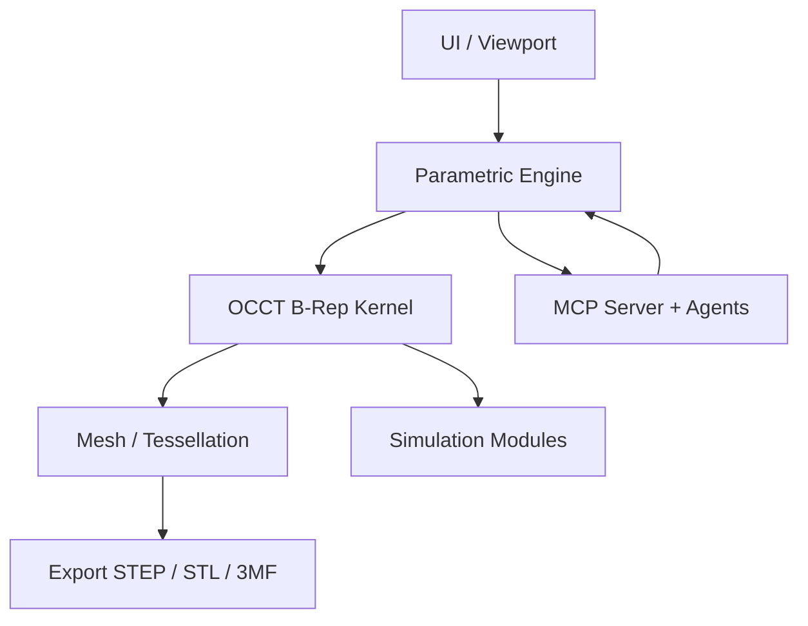

# Full Project Vision (Post-MVP)

**Status**: Independent of MVP  
**Date**: 2026-10-20  
**Purpose**: Long-term goals. Update only when the overall direction changes. Do not mix with MVP scope.

## Overview

High-performance CAD/CAM software that combines the best of Autodesk (integrated parametric + CAM), FreeCAD (open B-Rep + extensibility), Blender (freeform/sculpting + performance), and Adobe (2D vector excellence + materials). AI/MCP is first-class. Target: desktop native with optional browser portability.

> [!NOTE]
> This document is deliberately separate from the MVP. MVP iterations and scope cuts stay in `/mvp/`. This vision remains stable.

## Core Capabilities (Beyond MVP)

- Full parametric B-Rep modeling with advanced history, constraints, and assemblies.
- Hybrid freeform/sculpting tools (Blender-style) that remain editable.
- 2D vector drafting and technical drawings with associative views.
- Complete CAM: 2.5D to 5-axis toolpaths, machine simulation, probing, post-processors, additive support.
- Simulations: structural FEA, thermal, motion/kinematic, manufacturability checks.
- Generative design and optimization.
- Sheet metal, basic PCB/electronics integration.
- Rendering and material authoring.
- Collaboration, version control, and data management.
- Expanded MCP agents for design suggestion, optimization, and automated CAM prep.

## Architecture Direction

- Kernel: OpenCASCADE (or equivalent high-performance B-Rep).
- Language: C++ for core geometry; scripting layer (Python or similar) for extensibility.
- Optional WASM path for browser portability, with native desktop as primary for performance.
- Modular workbench-style architecture for future extensions.

## Key Differentiators

- AI-native: natural language drives modeling, validation, and manufacturing prep.
- Unified 2D/3D workspace that does not force mode switching.
- Print-first export quality even in the full product.
- Open enough for custom workbenches while remaining high-performance.

## Relationship to MVP

The MVP proves the core design-to-print loop and MCP integration.  
Successful MVP features become the foundation; everything listed above is post-MVP.

> [!IMPORTANT]
> Do not expand MVP scope based on this document. Record new long-term ideas here only.
